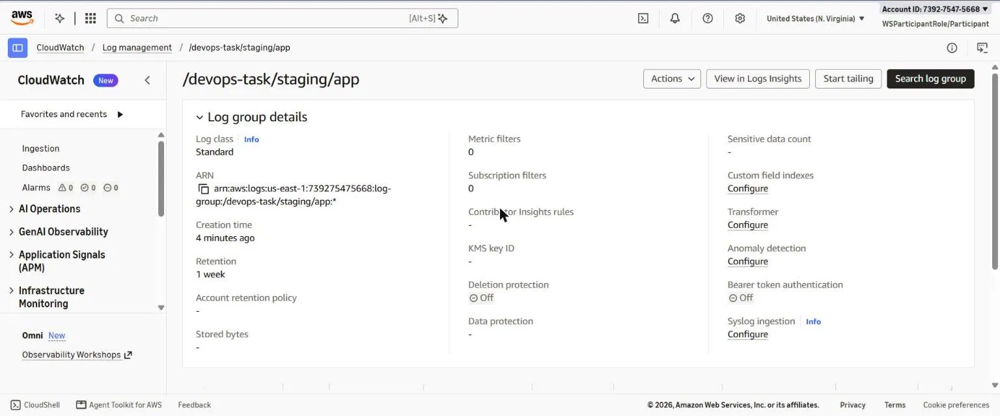

# DevOps Task API — Step 1: Application & Containerization

A small FastAPI service that is the base for the DevOps assessment.

## Endpoints

| Method | Path       | Description |
|--------|------------|-------------|
| GET    | `/`        | `{"message": "Hello from DevOps Task!", "status": "running", "version": "<APP_VERSION>"}` |
| GET    | `/health`  | Liveness/readiness check. `200 {"status":"ok"}` once started, `503` while starting/stopping |
| GET    | `/metrics` | Prometheus metrics |

### Metrics exposed
- `http_requests_total{method,path,status}` — request count
- `http_errors_total{method,path}` — 5xx / unhandled exceptions
- `http_request_duration_seconds` — latency histogram (p50/p95/p99 via `histogram_quantile`)
- `app_info{version,env}` — build info

`path` uses the **route template**, not the raw URL (unknown URLs → `unmatched`), so label cardinality stays bounded.

## Configuration (environment variables)

| Variable      | Default       | Purpose |
|---------------|---------------|---------|
| `PORT`        | `8080`        | Listen port |
| `LOG_LEVEL`   | `INFO`        | `DEBUG` / `INFO` / `WARNING` / `ERROR` |
| `APP_ENV`     | `development` | Environment name (added to every log line) |
| `APP_VERSION` | `0.1.0`       | Reported by `/` and `app_info` |
| `FAULT_INJECTION` | `false`   | Demo only: adds `GET /debug/fail` (always 500) to exercise error metrics, logs and alerts |

## Logging
All logs (app + uvicorn) are single-line JSON on stdout, e.g.:
```json
{"timestamp":"...","level":"info","logger":"app","message":"request completed","env":"local","method":"GET","path":"/","status":200,"duration_ms":0.61}
```

## Graceful shutdown
The container runs `python -m app.main` in exec form, so Python is PID 1 and receives `SIGTERM` directly. Uvicorn stops accepting connections, drains in-flight requests (up to 20s), then the lifespan hook marks the app not-ready and logs shutdown. Compose `stop_grace_period` is 30s.

## Run locally

```bash
# Python
python -m venv .venv && source .venv/bin/activate
pip install -r requirements-dev.txt
python -m app.main            # http://localhost:8080

# Tests + coverage + lint
pytest
ruff check app tests

# Docker Compose: the app only
docker compose up --build -d app
curl localhost:8080/ && curl localhost:8080/health && curl localhost:8080/metrics
docker compose ps             # shows (healthy)
```

## Observability (Prometheus, Grafana, Loki, Alloy, Node Exporter, cAdvisor)

```bash
openssl rand -base64 18 > secrets/grafana_admin_password   # Grafana admin password (Docker secret)
docker compose up -d --build                               # app + full monitoring stack
```

Grafana: http://localhost:3000 (user `admin`, password from the file above). The Application, Host
and Containers dashboards, data sources and 11 alert rules are all provisioned from `monitoring/`.
Only Grafana (on 127.0.0.1) and the app publish ports. Details, label and threshold reasoning, and
the error-spike walkthrough: **[docs/observability.md](docs/observability.md)**.

## Kubernetes (kind)

```bash
bash scripts/kind-up.sh            # kind cluster + Contour + metrics-server + deploy (needs kind >= v0.33)
bash scripts/k8s-verify.sh         # 13 checks: ingress, non-root, read-only FS, NetworkPolicy, Pod Security, HPA
bash scripts/k8s-rollout-demo.sh   # zero-downtime rolling update + kubectl rollout undo, under traffic
curl http://devops-task.localtest.me:8088/
```

Kustomize base + kind overlay in `k8s/`: a 2-replica Deployment (probes, requests/limits, restricted
securityContext), Service, Ingress, HPA, PDB and NetworkPolicy. Design notes, command output and the
production-on-EKS comparison: **[docs/kubernetes.md](docs/kubernetes.md)**.

## Deployment evidence (AWS)

The Terraform in `terraform/` was run against an **AWS Workshop Studio sandbox** (account
739275475668, us-east-1, role `WSParticipantRole`). Every init, plan, apply and destroy output is in
[`docs/evidence/aws/`](docs/evidence/aws/SUMMARY.md).

**What the sandbox allowed.** The role is read-only by design: `ReadOnlyAccess`, IAM read,
CloudWatch-agent and SSM-agent policies, and everything outside us-east-1 denied. Denied during the run:

| Action | Needed for | Result |
|--------|------------|--------|
| `s3:CreateBucket` | remote-state bucket (bootstrap) | AccessDenied |
| `ec2:RunInstances`, `ec2:CreateSecurityGroup` | EC2 host and security group (app) | UnauthorizedOperation (checked with `--dry-run`) |
| `ecr:CreateRepository` | image registry (shared) | AccessDenied |
| `iam:CreateOpenIDConnectProvider` (and so the CI roles behind it) | GitHub OIDC (shared) | AccessDenied |
| `logs:TagResource` | creating the log group *with* the stack's default tags | AccessDenied |
| `logs:DeleteLogGroup` | destroy | AccessDenied |

**What succeeded.**
- **`terraform plan` against the real account:**
  - bootstrap: 7 to add (versioned, encrypted, TLS-only state bucket)
  - shared: 5 to add (immutable ECR repo with lifecycle, OIDC provider, push role)
- The app plan stops where it reads the shared stack's ECR repository and OIDC provider, which could
  not be created.
- **`terraform apply`** of the one app resource the role may create: the staging log group
  `/devops-task/staging/app` with **7-day retention**. Default tags were switched off through a
  local, git-ignored override, because `logs:TagResource` is denied.
- Destroy was denied (`logs:DeleteLogGroup`). The empty log group remains until the sandbox account
  is torn down.



**Terraform tests: the full plan, without AWS.** `terraform test` plans each stack completely
against a mocked AWS provider (`terraform/*/tests/*.tftest.hcl`) and runs in CI on every Terraform PR:
- **shared, 3 passed:** immutable and scanned ECR, lifecycle expires tagged releases only, OIDC
  provider created (or reused), push role trusted only from `main`, S3 backend with `use_lockfile`.
- **app, 4 passed:**
  - the security group sits in the default VPC, ingress is 80/tcp only and **never port 22**,
    egress is 443 only
  - the EC2 instance uses the IAM instance profile, **IMDSv2 required** (hop limit 1), encrypted root disk
  - `user_data` installs and starts Docker and installs the deploy script that runs the container
  - log retention is read from the real env files: **staging 7 / production 30**
  - the deploy role trusts only its own GitHub Environment
  - the S3 backend uses `use_lockfile`
  - invalid environment or retention values are rejected
- **Mutation check:** making IMDSv2 optional, changing staging retention to 14, or opening port 22
  each fails the test.

**In an AWS account whose identity may create these resources, `terraform apply` of `bootstrap`,
`shared` and `app` (see [terraform/README.md](terraform/README.md)) deploys the complete stack.**
The release pipeline then builds, pushes and deploys to it ([docs/ci-cd.md](docs/ci-cd.md)).

## Dockerfile notes
- **Multi-stage**: builder installs deps into `/install`; runtime copies only that + `app/`.
- **Base pinned**: `python:3.12.16-alpine3.24@sha256:c5ba3dee…` — version tag for readability, multi-arch index digest for immutability.
- **Minimal**: Alpine; pip removed from the runtime filesystem (fewer CVEs, no package installs at runtime).
- **Non-root**: UID/GID `10001`. App code is root-owned, so the runtime user can read but not modify it.
- **HEALTHCHECK** uses Python's `urllib` (no curl needed).
- **OCI labels** with version, git SHA, and build date passed as build args.
- Compose also runs it `read_only` with `/tmp` as tmpfs, `no-new-privileges`, CPU/memory limits, and `restart: unless-stopped`.

**Final image size: 76.5 MB uncompressed, ~24 MB compressed** (what a registry pull transfers),
measured for linux/amd64:

| Layer | Size |
|-------|------|
| `python:3.12.16-alpine3.24` base | 56.0 MB |
| Python dependencies (FastAPI, uvicorn, prometheus-client) | 20.4 MB |
| App code | 57 kB |

(`docker image ls` on Docker Desktop shows ~101 MB because the containerd image store counts
the compressed blobs as well. The sum of `docker history` layer sizes is the real on-disk size.)

```bash
docker build \
  --build-arg APP_VERSION=0.1.0 \
  --build-arg GIT_SHA=$(git rev-parse --short HEAD) \
  --build-arg BUILD_DATE=$(date -u +%Y-%m-%dT%H:%M:%SZ) \
  -t devops-task-api:0.1.0 .
```

## Project layout
```
app/
  main.py            # FastAPI app, middleware, endpoints, entrypoint
  config.py          # env-var config
  logging_config.py  # JSON logging
  metrics.py         # Prometheus metrics
tests/test_main.py   # unit tests
Dockerfile
.dockerignore
docker-compose.yml
requirements.txt / requirements-dev.txt
pyproject.toml       # pytest + ruff config
```
