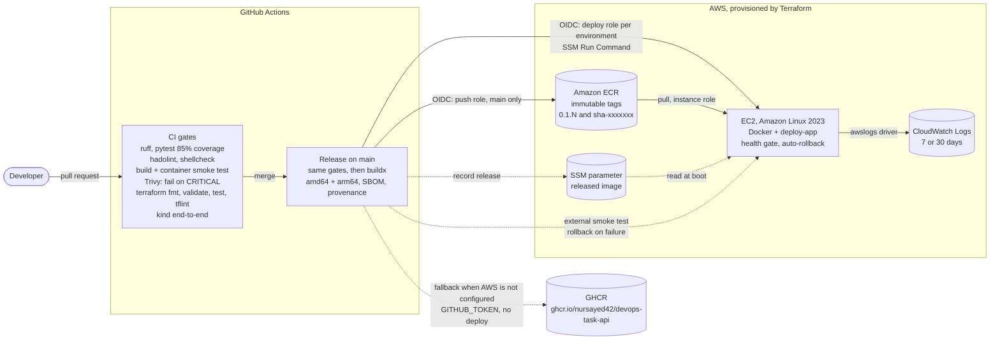
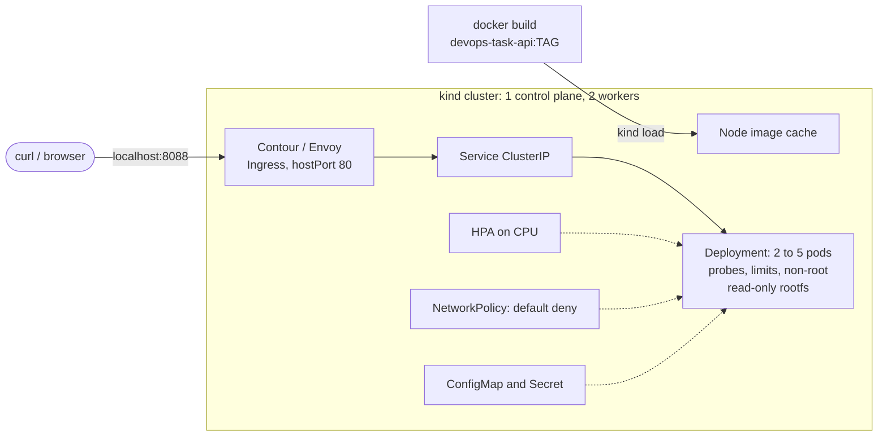
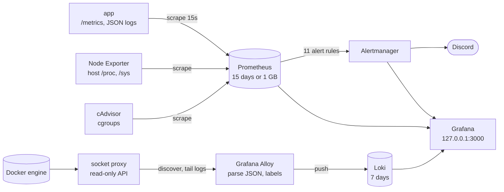
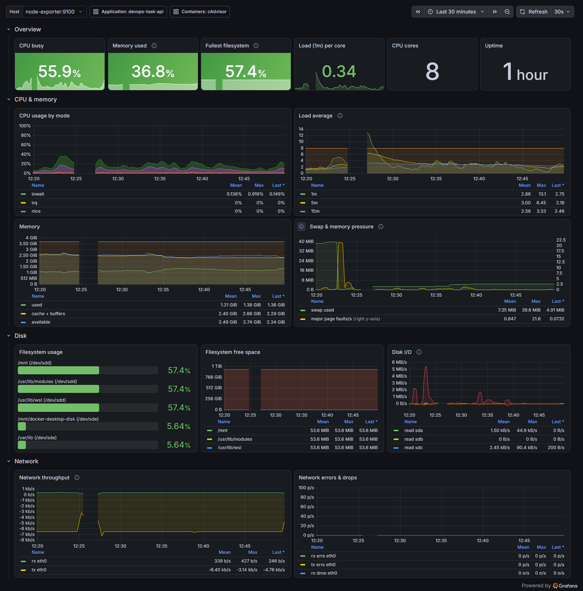
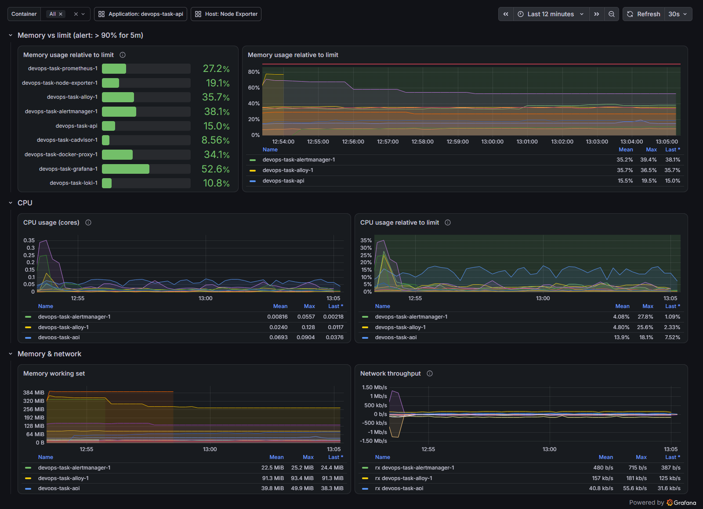
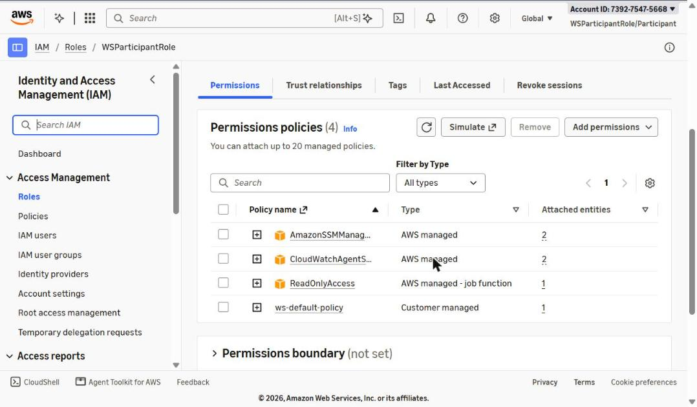
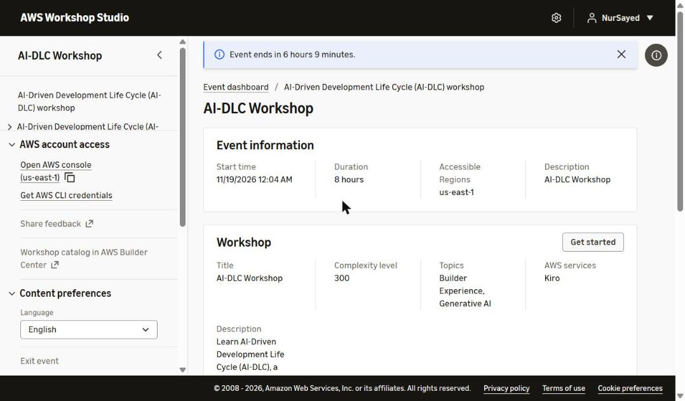

# devops-task

A small FastAPI service taken from source code to a tested, scanned, observable and securely
deployed state. The repository holds the container image, CI/CD with security gates, AWS
infrastructure as code, a Kubernetes deployment, a full metrics-and-logs stack, an operational
health script, and the evidence that each of them works.

| Step | Where | Evidence |
|------|-------|----------|
| 1. App & container | [`app/`](app), [`Dockerfile`](Dockerfile), [`docker-compose.yml`](docker-compose.yml) | 15 unit tests (95% coverage); image 76.6 MB; CI smoke-tests health, non-root and SIGTERM |
| 2. CI/CD | [`.github/workflows/`](.github/workflows), [docs/ci-cd.md](docs/ci-cd.md) | Every PR in this repo went through it; releases publish to GHCR; actions pinned by SHA, OIDC only. **The EC2 deploy has not run** (see below) |
| 3. Terraform | [`terraform/`](terraform), [terraform/README.md](terraform/README.md) | Plans against a read-only AWS sandbox (applies denied), mocked `terraform test`, [sandbox evidence](#deployment-evidence-aws) |
| 4. Kubernetes | [`k8s/`](k8s), [docs/kubernetes.md](docs/kubernetes.md) | kind e2e in CI; 0 failed requests over rolling update + `rollout undo` |
| 5. Observability | [`monitoring/`](monitoring), [docs/observability.md](docs/observability.md) | 3 provisioned dashboards (screenshots), 11 unit-tested alert rules, alert fired end to end |
| 6. Health script | [`scripts/system_health.sh`](scripts/system_health.sh), [docs/system-health.md](docs/system-health.md) | 34 tests in CI; hardened systemd unit verified under systemd |
| 7. Documentation | this file + `docs/` | |

**Not done: a deploy to a real EC2 instance.** The only AWS account I had was a read-only AWS
Workshop Studio sandbox, which has since expired. So the Terraform was planned but not applied
(apart from one log group). The deploy job of Step 2, with its smoke test and automatic rollback,
has never run against a real host. Both are complete in the repository. Without AWS, the Terraform
is checked by mocked `terraform test` for every stack, and the deploy scripts by shellcheck.
Details and logs: [Deployment evidence](#deployment-evidence-aws).

**Contents:** [Quick start](#quick-start) ·
[Running everything](#running-everything) · [Architecture](#architecture) ·
[Dashboards & incident walkthrough](#observability-dashboards-and-an-incident-walkthrough) ·
[Kubernetes rollout & EKS](#kubernetes-zero-downtime-rollout-rollback-and-the-eks-path) ·
[The application](#the-application) · [Design decisions](#design-decisions) ·
[Deployment & rollback](#deployment--rollback-strategy) · [Security](#security-considerations) ·
[Deployment evidence](#deployment-evidence-aws) · [AWS cost](#aws-cost-estimate-production) ·
[Improvements](#what-i-would-improve-with-more-time) · [AI usage](#use-of-ai-tools)

---

## Quick start

**Prerequisites**

| Tool | Version | For |
|------|---------|-----|
| Docker with Compose v2.20+ | Docker Desktop or Engine | everything local (Compose `include` needs 2.20+) |
| bash | Linux/macOS, or Git Bash / WSL on Windows | the scripts |
| Python | 3.12 (3.11+ works) | running the app and tests without Docker |
| kind + kubectl | kind **≥ v0.33.0**, kubectl 1.36 | the Kubernetes part |
| Terraform + AWS CLI v2 | Terraform ≥ 1.10 (CI: 1.17.2) | the AWS part |

Give Docker at least ~4 GB of RAM for the Compose stack. The Compose stack and the 3-node kind
cluster together need more than a 4 GB Docker Desktop VM, so stop one (`docker compose stop`)
before starting the other.

**Run the app and the observability stack**

```bash
git clone https://github.com/NurSayed42/devops-task.git && cd devops-task
cp .env.example .env                                         # optional: app settings, Grafana user
openssl rand -base64 18 > secrets/grafana_admin_password     # Grafana admin password (a Docker secret)
docker compose up -d --build                                 # app + Prometheus, Grafana, Loki, Alloy,
                                                             # Node Exporter, cAdvisor, Alertmanager
docker compose ps                                            # all Up; app, prometheus, grafana (healthy)
curl localhost:8080/        # {"message":"Hello from DevOps Task!","status":"running","version":"0.1.0"}
```

| URL | What |
|-----|------|
| http://localhost:8080 | the app (`/`, `/health`, `/metrics`) |
| http://localhost:3000 | **Grafana**. User `admin`, password = contents of `secrets/grafana_admin_password`. Dashboards: **Dashboards → DevOps Task → Application / Host / Containers**; the Application dashboard is the home page. |

Nothing else is published to the host: Prometheus, Loki, Alloy, the exporters and Alertmanager sit
on an internal Docker network. To see errors and alerts on the dashboards, run the app with its
opt-in fault-injection route and send some traffic:

```bash
FAULT_INJECTION=true docker compose up -d app
for i in $(seq 1 300); do curl -s -o /dev/null localhost:8080/; curl -s -o /dev/null localhost:8080/debug/fail; sleep 0.2; done
```

`docker compose up -d app` starts the app alone. `docker compose down` stops everything; add `-v`
to also delete the stored metrics, logs and Grafana data.

## Running everything

**Unit tests, lint and coverage** (CI fails below 85% coverage):

```bash
python -m venv .venv && source .venv/bin/activate     # Windows: .venv\Scripts\activate
pip install -r requirements-dev.txt
pytest                                    # 15 tests + coverage report
ruff check app tests && ruff format --check app tests
python -m app.main                        # run without Docker on :8080
```

**Container image**

```bash
docker build --build-arg APP_VERSION=0.1.0 --build-arg GIT_SHA=$(git rev-parse --short HEAD) \
  --build-arg BUILD_DATE=$(date -u +%Y-%m-%dT%H:%M:%SZ) -t devops-task-api:0.1.0 .
```

**Health script** ([docs](docs/system-health.md)):

```bash
./scripts/system_health.sh                              # text report, appends to ./health_log.txt
./scripts/system_health.sh --disk 80 --cpu 90 --mem 85 --json
echo $?                                                 # 0 OK, 1 WARNING, 2 CRITICAL, 3 UNKNOWN
bash scripts/tests/test_system_health.sh                # 34 tests (Linux)
# every 5 minutes, via systemd (or the cron line in the docs):
sudo install -m 0755 scripts/system_health.sh /usr/local/bin/system_health.sh
sudo install -m 0644 scripts/systemd/system-health.{service,timer} /etc/systemd/system/
sudo systemctl daemon-reload && sudo systemctl enable --now system-health.timer
```

**Alert rules and monitoring configs** (also run in CI):

```bash
docker run --rm -v "$PWD/monitoring/prometheus:/etc/prometheus:ro" -w /etc/prometheus/tests \
  --entrypoint promtool prom/prometheus:v3.16.0 test rules alerts_test.yml
```

In Git Bash on Windows, put `MSYS_NO_PATHCONV=1` in front and use `$(pwd -W)` instead of `$PWD`.
Otherwise Git Bash rewrites `/etc/prometheus/tests` into a Windows path.

**Terraform** ([full guide](terraform/README.md)):

```bash
# Without AWS: validate and run the mocked-provider tests (from the repo root)
(cd terraform/app && terraform init -backend=false && terraform validate && terraform test)

# With AWS credentials (us-east-1), from the repo root: state bucket -> ECR + OIDC -> staging host
export AWS_REGION=us-east-1
STATE_BUCKET="devops-task-tfstate-$(aws sts get-caller-identity --query Account --output text)"
cd terraform/bootstrap && terraform init && terraform apply
cd ../shared && terraform init -backend-config="bucket=${STATE_BUCKET}" && terraform apply
cd ../app && terraform init -backend-config=envs/staging.s3.tfbackend -backend-config="bucket=${STATE_BUCKET}"
terraform apply -var-file=envs/staging.tfvars
```

**Kubernetes** ([docs](docs/kubernetes.md)):

```bash
docker compose stop                     # free RAM on a small Docker Desktop VM
bash scripts/kind-up.sh                 # cluster + Contour + metrics-server + image + deploy (idempotent)
curl http://devops-task.localtest.me:8088/
bash scripts/k8s-verify.sh              # 13 checks: ingress, hardening, NetworkPolicy, Pod Security, HPA
bash scripts/k8s-rollout-demo.sh        # zero-downtime rolling update + kubectl rollout undo, under traffic
bash scripts/k8s-hpa-demo.sh            # HPA scales out under load
kubectl -n devops-task port-forward svc/devops-task-api 8081:80   # alternative to the Ingress
kind delete cluster --name devops-task
```

**CI/CD** needs **no secrets**. Every push to `main` runs the CI gates and a Trivy gate on the
release candidate, then publishes a multi-arch image (linux/amd64 + linux/arm64, tags `0.1.N` and
`sha-<7>`, never `latest`, with SBOM and provenance) to one of two registries:

| Registry | When | Authentication | Job permission |
|----------|------|----------------|----------------|
| **Amazon ECR** (primary), then staging/production deploy via SSM | repository variables `AWS_REGION`, `ECR_REPOSITORY`, `AWS_ECR_PUSH_ROLE_ARN` are set (plus `AWS_DEPLOY_ROLE_ARN` per GitHub Environment), all from Terraform outputs | OIDC, short-lived role credentials | `id-token: write` |
| **GHCR** (fallback): `ghcr.io/nursayed42/devops-task-api`, no deploy | any of those variables is missing (no configuration needed) | the workflow's own `GITHUB_TOKEN` | `packages: write` |

When the GHCR fallback is used, the deploy jobs are skipped and the build summary states why. See
[docs/ci-cd.md](docs/ci-cd.md#registries).

---

## Architecture

### Code commit → CI → registry → EC2



### Kubernetes deployment flow



### Observability: how metrics and logs reach Grafana



---

## Observability: dashboards and an incident walkthrough

All three dashboards are provisioned from [`monitoring/grafana/dashboards/`](monitoring/grafana/dashboards).
The screenshots were taken from the running stack during a deliberate error spike (the app was run
with `FAULT_INJECTION=true` under load).

**Application:** request rate, 5xx error rate, latency p50/p95/p99, and the Loki logs on the same time axis.


**Host:** CPU, memory, disk and network from Node Exporter.



**Containers:** per-container CPU and memory from cAdvisor, including memory relative to the configured limit.



### "An error spike appears on the Application dashboard. How do you find the cause using these tools?"

1. **Prometheus: confirm and scope it.**
   - The *Error rate (5xx) %* panel shows when the spike started and how far it is above the 5%
     alert line.
   - Its second series, `sum by (path) (rate(http_errors_total[5m]))`, shows **which route** fails.
   - *Request rate by route and status* tells whether it's one endpoint or everything. In the demo,
     `/debug/fail 500` rose while `/ 200` stayed flat.
   - *Latency p95 by route* shows whether that route is also slow.
2. **Loki logs panel: see what failed, on the same screen and time axis.**
   - *Log lines by level* has an `error` bar directly under the spike (shared crosshair).
   - *Error and warning logs* lists one line per failure, e.g. `GET /debug/fail  unhandled exception`.
   - Expanding a line shows every JSON field and the traceback
     (`RuntimeError: fault injected via /debug/fail` in `app/main.py`).
3. **Structured metadata filter: narrow it down in Explore.** `path`, `method` and `status` are
   attached to every app log line, so there is no regex over raw text:
   ```logql
   {service="app", level="error"} | path="/debug/fail"
   sum by (path) (count_over_time({service="app"} | status=~"5.." [1m]))
   ```
4. **Container metrics: rule out the platform.**
   - On *Containers*: is `devops-task-api` near its memory limit (OOM risk) or pinned at 100% of its
     CPU limit (throttling)?
   - On *Host*: is disk or memory exhausted?
   - On *Application*: did *Uptime* reset (a crash) or *Version* change (a fresh deploy)?
5. **Alert: confirm and act.**
   - `AppHighErrorRate` (5xx above 5% for 5 minutes) goes pending, then firing, and Alertmanager
     routes it to Discord. It is also visible under Grafana → Alerting. Here it went pending at
     06:26:56 and fired at 06:32:01.
   - If the spike began with a new version, roll back (Deploy workflow with the previous version).
     If it's one route with a clear traceback, fix the code. If a container is at its limit,
     `ContainerMemoryNearLimit` or `ContainerOomKilled` will have fired too.
   - The alert resolves on its own once the error rate drops.

More detail on labels, retention and alert thresholds: [docs/observability.md](docs/observability.md).

---

## Kubernetes: zero-downtime rollout, rollback and the EKS path

### Rolling update and `kubectl rollout undo`

[`scripts/k8s-rollout-demo.sh`](scripts/k8s-rollout-demo.sh) sends a request through the Ingress
every ~50 ms while it rolls the Deployment from `0.1.0` to `0.2.0` and back. Any response other
than 200 within 5 s fails it. Zero downtime comes from:
- `maxUnavailable: 0` / `maxSurge: 1` and readiness gating
- a 10 s `preStop` drain
- a 65 s app keep-alive
- ingress retries of transport-level failures

See [how it got to zero](docs/kubernetes.md#how-it-got-to-zero). The transcript below comes from a
kind cluster created from scratch by `kind-up.sh`, with kind v0.33.0 and the pinned Kubernetes
v1.36.4, the same versions CI uses.

```
$ kubectl -n devops-task set image deployment/devops-task-api api=devops-task-api:0.2.0
deployment.apps/devops-task-api image updated

$ kubectl -n devops-task rollout status deployment/devops-task-api --timeout=180s
deployment "devops-task-api" successfully rolled out
  Responses during the update:
        81 x HTTP 200  version 0.1.0
        40 x HTTP 200  version 0.2.0

$ kubectl -n devops-task rollout history deployment/devops-task-api
REVISION  CHANGE-CAUSE
1         running devops-task-api:0.1.0
2         set image devops-task-api:0.2.0

$ kubectl -n devops-task rollout undo deployment/devops-task-api
deployment.apps/devops-task-api rolled back

$ kubectl -n devops-task rollout status deployment/devops-task-api --timeout=180s
deployment "devops-task-api" successfully rolled out
  Responses during the rollback:
        38 x HTTP 200  version 0.1.0
        69 x HTTP 200  version 0.2.0

$ kubectl -n devops-task rollout history deployment/devops-task-api
REVISION  CHANGE-CAUSE
2         set image devops-task-api:0.2.0
3         rollout undo to devops-task-api:0.1.0

### Result: 237 requests through the Ingress, 0 not answered with 200 (slowest 1.581s)
```

Both versions answered side by side during the swap, and `rollout undo` brought revision 1 back as
revision 3, with no failed request. The full transcript is in
[docs/kubernetes.md](docs/kubernetes.md#zero-downtime-rolling-update-and-rollback).

### What changes for production on EKS

- **Ingress:** the AWS Load Balancer Controller provisions an ALB from the Ingress (or Gateway API),
  with TLS from ACM, AWS WAF and external-dns for Route 53, instead of Contour on a hostPort.
- **Secrets:** the External Secrets Operator syncs values from AWS Secrets Manager or SSM Parameter
  Store into the same mounted Secret, and EKS envelope-encrypts Secrets with KMS. Nothing is
  generated from local files.
- **Node autoscaling:** Karpenter (or Cluster Autoscaler on managed node groups) adds nodes when the
  HPA's pods don't fit, across three AZs. Zone topology spread and the PDB keep upgrades and drains
  safe.
- **IAM for pods:** the `devops-task-api` ServiceAccount maps to an IAM role through IRSA or EKS Pod
  Identity, scoped to exactly what the app needs. Pods never use the node's role (IMDSv2, hop limit 1).
- **Full comparison** (images, delivery with GitOps and canaries, network policy, observability):
  [docs/kubernetes.md](docs/kubernetes.md#how-this-changes-for-production-on-eks).

---

## The application

| Method | Path | Response |
|--------|------|----------|
| GET | `/` | `{"message": "Hello from DevOps Task!", "status": "running", "version": "<APP_VERSION>"}` |
| GET | `/health` | `200 {"status":"ok"}` once started, `503` while starting or stopping. Used as liveness and readiness. |
| GET | `/metrics` | Prometheus: `http_requests_total{method,path,status}`, `http_errors_total{method,path}`, `http_request_duration_seconds` histogram, `app_info{version,env}` |

- **Config** comes only from environment variables: `PORT` (8080), `LOG_LEVEL` (INFO), `APP_ENV`
  (development), `APP_VERSION` (baked in at build time), and the demo-only `FAULT_INJECTION`
  (false), which adds `GET /debug/fail`.
- **Logs** are one JSON object per line on stdout, uvicorn's included. An unhandled exception
  produces exactly one error line with the traceback. A test enforces this, because re-raising
  had made uvicorn log every failure a second time.
- **Metric labels** use the route *template* (`/`, `/health`, `unmatched`), never the raw URL,
  so a scanner hitting random paths can't explode cardinality.
- **Graceful shutdown:** Python is PID 1 (exec-form entrypoint), so on SIGTERM uvicorn stops
  accepting connections and drains in-flight requests (20 s), within the 30 s grace period of
  Compose and Kubernetes. Idle keep-alive connections stay open 65 s, longer than Envoy's and an
  ALB's 60 s, which avoids proxy 502/503s.

**Image:** multi-stage build; `python:3.12.16-alpine3.24` pinned by **version and multi-arch
digest**; dependencies built in a separate stage; non-root UID 10001; app code root-owned
(read-only to the app); pip removed from the runtime filesystem; `HEALTHCHECK`; OCI labels
(version, revision, created, source).

**Final image size: 76.6 MB uncompressed, ~24 MB compressed** (linux/amd64):

| Layer | Size |
|-------|------|
| `python:3.12.16-alpine3.24` base | 56.0 MB |
| Python dependencies (FastAPI, uvicorn, prometheus-client) | 20.4 MB |
| Runtime user, pip removed | 57 kB |
| App code | 33 kB |

(`docker image ls` on Docker Desktop shows ~101 MB because its containerd image store also counts
the compressed blobs.)

---

## Design decisions

**Alpine instead of distroless.**
- *Distroless* (`gcr.io/distroless/python3`) has no shell or package manager, the smaller attack
  surface. But its Python is whatever the Debian release ships (3.11 on Debian 12), it can't be
  pinned to the 3.12 the code targets, and there's nothing in the image to debug with.
- *python:3.12-alpine* gives an exact, pinnable Python and a small image. Musl wheels exist for
  every dependency.
- The extra attack surface is reduced: pinned by digest, pip removed, non-root, read-only root
  filesystem, all capabilities dropped, and Trivy fails the build on any CRITICAL CVE.
- Next step: a Chainguard/Wolfi Python image (distroless-style *and* a chosen Python version).

**EC2 instead of ECS or EKS** (for the AWS target).
- The task asks for EC2, and for one stateless container it is the simplest and cheapest option.
- The costs are ours to carry: patching the OS (handled by replacing hosts:
  `user_data_replace_on_change`, and a replaced host redeploys the release recorded in SSM) and
  rolling deploys (handled by the health-gated `deploy-app` script).
- With more services I'd move to **ECS on Fargate**: no hosts, native rolling and blue/green
  deploys behind an ALB, and task IAM roles.
- **EKS** pays off once there's a platform with many services and teams. Its control plane alone is
  ~$73/month. The Kubernetes manifests here are ready for that, see
  [docs/kubernetes.md](docs/kubernetes.md#how-this-changes-for-production-on-eks).

**Deploying with SSM Run Command, not SSH.** No inbound port 22, no SSH keys to distribute or
rotate, and every command is IAM-authorised and logged in CloudTrail. The CI role may run commands
only on its own environment's instance.

**Tagging.**
- Semantic version = `MAJOR.MINOR` from the `VERSION` file (changed in a reviewed PR) plus the
  workflow run number as PATCH, e.g. `0.1.42`. Every release is unique and increasing, with no tag
  races. A second tag, `sha-<7 chars>`, traces an image to its commit, and the commit is tagged
  `v0.1.42` in git.
- **ECR tags are immutable** and `latest` is never pushed, so "deploy 0.1.41" always means the image
  that was tested as 0.1.41. On the GHCR fallback, where tags are mutable, the pipeline checks for
  an existing tag and never overwrites it.

**Secrets.** There are none in git and none in GitHub:
- **GitHub → AWS:** OIDC with short-lived credentials. Role ARNs are plain variables.
- **Hosts:** instance profile.
- **Grafana admin password:** a Docker secret file, with a fail-closed entrypoint guard. Grafana's
  own entrypoint silently falls back to admin/admin when the secret can't be read; this was found
  and fixed while testing.
- **Kubernetes Secret:** generated from a git-ignored file and mounted as a read-only file, not an
  env var. In production: External Secrets Operator + AWS Secrets Manager.
- **Webhook URLs:** files or environment variables, never flags (flags show up in `ps`).

**Log labels.** Loki indexes labels, so only low-cardinality ones are labels:
- `service`, `container`, `stream` and `level` (~5 values), about 10–20 streams in total.
- The app's `path`, `method` and `status` are *structured metadata*: filterable
  (`{service="app"} | status=~"5.."`) without creating streams.
- Request IDs, IPs and durations stay in the log line.
- Successful health checks and scrapes are dropped at the collector (counted, not silently lost).

**Infrastructure layout.**
- Three Terraform stacks with separate state:
  - **bootstrap:** the state bucket
  - **shared:** ECR and GitHub OIDC
  - **app:** one per environment via `envs/<env>.tfvars` and its own state key
- Locking uses S3's native lockfile, no DynamoDB.
- Least-privilege IAM written out as policy documents, not managed `*FullAccess` policies.

**Other choices.**
- **Kustomize over Helm:** plain YAML plus overlays, no templating needed for one service.
- **Contour over ingress-nginx:** ingress-nginx was retired upstream in March 2026.
- **Alloy:** the collector the task names; it is also Promtail's successor.
- **Alertmanager → Discord:** grouped, with inhibition, resolved notifications, and a URL file
  secret.
- **One Compose project:** the app's compose file `include`s the monitoring stack, so
  `docker compose up` brings up everything.

---

## Deployment & rollback strategy

**How a release reaches production**

1. **Pull request.** Every change goes through a PR and its CI gates:
   - lint, unit tests and coverage
   - hadolint and shellcheck
   - image build plus a container smoke test (health, UID, graceful SIGTERM)
   - **Trivy, failing on CRITICAL CVEs**
   - Terraform fmt, validate, mocked tests, tflint and a Trivy IaC scan
   - Prometheus, Loki, Alloy and Alertmanager config checks
   - for Kubernetes changes, a full kind end-to-end run
2. **Merge to `main`** runs the same gates again, plus a Trivy gate on the release candidate,
   then builds the multi-arch image once and pushes it to ECR under immutable tags, with an SBOM
   and provenance. Later stages deploy *that* image; nothing is rebuilt per environment. Without
   AWS configured, the same image goes to GHCR instead and steps 3–4 are skipped.
3. **Staging deploy** (GitHub Environment `staging`, OIDC role scoped to the staging instance):
   1. SSM runs `deploy-app <image>`. It pulls first, stops the old container with SIGTERM, starts
      the new one and waits up to 60 s for `/health` through the published port. **If it isn't
      healthy, the host restores the previous image itself.**
   2. CI smoke-tests from outside: `/health` must answer, and `/` must report the new version.
      **If that fails, CI runs `deploy-app --rollback`.**
   3. On success the image is recorded in SSM Parameter Store. A host that Terraform replaces later
      boots straight into it.
4. **Production** runs the same job against the `production` Environment. It is gated by
   **required reviewers** (a manual approval) and is opt-in via `DEPLOY_PRODUCTION`.
5. **After the deploy,** Prometheus alerts (error rate, latency, app down, container memory) watch
   the new version, and the Application dashboard shows its version and uptime next to the error
   logs.

**How to roll back**

| Situation | Action |
|-----------|--------|
| New container never becomes healthy | Automatic: the host restores the previous image |
| Healthy on the host but broken from outside | Automatic: CI runs `deploy-app --rollback` |
| A bad release passed both checks | **Actions → Deploy → Run workflow** with the previous version (e.g. `0.1.41`). Immutable tags make this exact, and the same checks run. |
| Fix it in history | `git revert` and merge: a new release through the full pipeline |
| CI unavailable | `aws ssm start-session --target <instance>` then `sudo deploy-app --rollback` |
| Kubernetes | Revert the image tag in the overlay and apply (GitOps). `kubectl rollout undo` as the emergency lever, demonstrated with 0 failed requests in [docs/kubernetes.md](docs/kubernetes.md) |

On a single EC2 host, swapping containers costs a few seconds. Zero-downtime on AWS needs two
instances behind an ALB (or ECS rolling deploys). The Kubernetes setup shows real zero-downtime
rollouts: `maxUnavailable: 0`, readiness gating, a `preStop` drain, and ingress retries of
transport-level failures.

---

## Security considerations

**Secrets management**
- No secret is committed: `.env`, `secrets/*`, Kubernetes `secrets.env`, Terraform state and
  local override files are git-ignored. Only README or `.example` files live next to them.
- GitHub holds **no secrets at all**. CI gets 1-hour AWS credentials through OIDC, and trust is
  pinned to `refs/heads/main` (push) or to a specific GitHub Environment (deploy).
- Runtime secrets are files with tight modes (Docker secrets; Kubernetes Secret volumes `0440` via
  `fsGroup`), never env vars, which leak into child processes and `docker inspect`.

**Image and supply chain**
- Base images are pinned by digest. Every GitHub Action is pinned to a full commit SHA. Linters run
  from digest-pinned images.
- Trivy scans every built image and **fails on any CRITICAL** (fixed or not; exceptions only via
  `.trivyignore` with an expiry date). ECR scans on push again. Release images carry an SBOM and
  provenance attestations.
- Trivy also scans the Terraform. The two accepted findings (HTTPS egress to AWS endpoints, SSE-S3
  instead of a CMK on the state bucket) are documented inline next to the code.

**IAM (least privilege)**

| Principal | Can | Scope |
|-----------|-----|-------|
| CI push role | push images | one ECR repo; assumable only from `main` |
| CI deploy role (per env) | `ssm:SendCommand`, put the release parameter | that environment's instance and parameter only |
| EC2 instance role | pull images, write logs, SSM agent | one repo (read), one log group (write, no create) |
| Containers on the host | nothing | IMDSv2 with hop limit 1: containers can't reach the instance credentials |

**Network exposure**
- **AWS:** the security group allows the app port in and **443 out only**. There is **no SSH**
  (Session Manager instead). IMDSv2 is required and the root volume is encrypted.
- **Compose:** only Grafana is published, on **127.0.0.1**. Everything else sits on an
  `internal: true` network. Alertmanager alone has an egress network (for Discord). No monitoring
  container mounts the Docker socket except cAdvisor and a GET-only socket proxy for Alloy.
- **Kubernetes:** the namespace enforces Pod Security **`restricted`**, and a **default-deny
  NetworkPolicy** lets only the ingress controller reach the pods (no egress at all). There's no
  service-account token. Pods run non-root with a read-only rootfs, drop every capability and use
  `RuntimeDefault` seccomp. `k8s-verify.sh` proves each of these is *enforced*, not just declared.
- **Host script:** the systemd unit runs as a `DynamicUser` with `ProtectSystem=strict` and no
  capabilities.

---

## Deployment evidence (AWS)

The Terraform in `terraform/` was run against an **AWS Workshop Studio sandbox** (account
739275475668, us-east-1, role `WSParticipantRole`). Every init, plan, apply and destroy output is in
[`docs/evidence/aws/`](docs/evidence/aws/SUMMARY.md).

**What the sandbox allowed.** The role is read-only by design: `ReadOnlyAccess`, IAM read,
CloudWatch-agent and SSM-agent policies, and everything outside us-east-1 denied. Denied during the run:

| Action | Needed for | Result |
|--------|------------|--------|
| `s3:CreateBucket` | remote-state bucket (bootstrap) | AccessDenied |
| `ec2:RunInstances`, `ec2:CreateSecurityGroup` | EC2 host and security group (app) | UnauthorizedOperation (checked with `--dry-run`) |
| `ecr:CreateRepository` | image registry (shared) | AccessDenied |
| `iam:CreateOpenIDConnectProvider` (and so the CI roles behind it) | GitHub OIDC (shared) | AccessDenied |
| `logs:TagResource` | creating the log group *with* the stack's default tags | AccessDenied |
| `logs:DeleteLogGroup` | destroy | AccessDenied |



*`WSParticipantRole` has four managed policies (ReadOnlyAccess, ws-default-policy, CloudWatchAgentServerPolicy, AmazonSSMManagedInstanceCore) and no permissions boundary: read-only apart from the agent policies.*



*The sandbox is an AWS Workshop Studio event account: an 8-hour event, accessible in us-east-1 only.*

**What succeeded.**
- **`terraform plan` against the real account:**
  - bootstrap: 7 to add (versioned, encrypted, TLS-only state bucket)
  - shared: 5 to add (immutable ECR repo with lifecycle, OIDC provider, push role)
- The app plan stops where it reads the shared stack's ECR repository and OIDC provider, which could
  not be created. Before that, it read the default VPC, its subnets and the AL2023 AMI from the real
  account and planned the 7 resources that don't depend on them: the log group, the instance role,
  its SSM policy attachment and instance profile, and the security group with its two rules.
- **`terraform apply`** of the one app resource the role may create: the staging log group
  `/devops-task/staging/app` with **7-day retention**. Default tags were switched off through a
  local, git-ignored override, because `logs:TagResource` is denied.
- Destroy was denied (`logs:DeleteLogGroup`). The empty log group remains until the sandbox account
  is torn down.


**Terraform tests: the full plan, without AWS.** `terraform test` plans each stack completely
against a mocked AWS provider (`terraform/*/tests/*.tftest.hcl`) and runs in CI on every Terraform PR:
- **shared, 3 passed:** immutable and scanned ECR, lifecycle expires tagged releases only, OIDC
  provider created (or reused), push role trusted only from `main`, S3 backend with `use_lockfile`.
- **app, 4 passed:**
  - the security group sits in the default VPC, ingress is 80/tcp only and **never port 22**,
    egress is 443 only
  - the EC2 instance uses the IAM instance profile, **IMDSv2 required** (hop limit 1), encrypted root disk
  - `user_data` installs and starts Docker and installs the deploy script that runs the container
  - log retention is read from the real env files: **staging 7 / production 30**
  - the deploy role trusts only its own GitHub Environment
  - the S3 backend uses `use_lockfile`
  - invalid environment or retention values are rejected
- **Mutation check:** making IMDSv2 optional, changing staging retention to 14, or opening port 22
  each fails the test.

**In an AWS account whose identity may create these resources, `terraform apply` of `bootstrap`,
`shared` and `app` (see [terraform/README.md](terraform/README.md)) deploys the complete stack.**
The release pipeline then builds, pushes and deploys to it ([docs/ci-cd.md](docs/ci-cd.md)).

**Release pipeline on `main` (GHCR fallback):**
[Release run #6](https://github.com/NurSayed42/devops-task/actions/runs/44383142296) (commit `49859a9`)
ran the CI gates, passed the Trivy gate on the release candidate, and pushed a multi-arch image to
[`ghcr.io/nursayed42/devops-task-api`](https://github.com/NurSayed42/devops-task/pkgs/container/devops-task-api).
- Tags `0.1.6` and `sha-49859a9`, plus the git tag `v0.1.6`.
- The ECR steps and the staging/production deploys were skipped, because the AWS variables are not
  set.
- [`docs/evidence/ci/ghcr-manifest.txt`](docs/evidence/ci/ghcr-manifest.txt) is
  `docker buildx imagetools inspect` without credentials. It shows **linux/amd64 and linux/arm64**
  manifests, an SBOM/provenance attestation for each, both tags on the same index digest, and the
  `org.opencontainers.image.source` annotation that links the package to this repository.

**Other evidence in the repo:**
- Grafana [dashboard screenshots](docs/observability.md#dashboards), and an alert that fired end to
  end (pending at 06:26:56, firing at 06:32:01 after its 5-minute `for`).
- The [Kubernetes rollout transcript](docs/kubernetes.md#zero-downtime-rolling-update-and-rollback).
- The health script's systemd unit verified under real systemd.
- Every PR's CI run in the Actions tab.

---

## AWS cost estimate (production)

The task asks for this estimate. Nothing was deployed, so it comes from list prices, not from a
bill. On-demand list prices for us-east-1, rounded, for a month (730 h). They are estimates. Savings
Plans would cut EC2 by ~30–40%.

**This design** (one host per environment). Production is priced at t3.small, the size
`envs/production.tfvars` recommends for real traffic. The file itself ships t3.micro, to stay in the
free tier for this task.

| Item | Production | Staging |
|------|-----------:|--------:|
| EC2 (t3.small prod / t3.micro staging), standard CPU credits | $15.20 | $7.60 |
| EBS gp3 16 GB, encrypted | $1.30 | $1.30 |
| Public IPv4 address | $3.65 | $3.65 |
| CloudWatch Logs (~2 GB ingested + storage at 30 / 7 days) | ~$1.10 | ~$0.55 |
| ECR (~2 GB of images, shared), S3 state, SSM Parameter Store/Run Command, IAM/OIDC | ~$0.25 | – |
| Data transfer out (first 100 GB/month free) | $0 | $0 |
| **Total** | **≈ $21/month** | **≈ $13/month** |

**What I'd run for real production traffic** (highly available, **≈ $65/month**, or **≈ $100**
with private subnets):
- 2 × t3.small across two AZs behind an ALB: ~$30 for instances plus ~$22 for the ALB (hourly + ~1 LCU)
- the ALB's public IPv4 addresses (2 AZs), ~$7.30
- logs and images, ~$3
- optionally private subnets with one NAT gateway, +$33 plus $0.045/GB processed

The monitoring stack self-hosted on a t3.medium with 50 GB gp3 adds ~$35. EKS instead of EC2 adds
**$73/month for the control plane alone**, before any nodes.

---

## What I would improve with more time

- **A real end-to-end AWS run:** apply all three stacks in an account that allows it, set the
  GitHub variables, and attach a release log of the CI deploy plus a forced rollback. The sandbox
  above only allowed plans.
- **A full app-stack plan against real AWS:** the sandbox expired before it could be taken. The
  mocked `terraform test` covers that plan (both environments) in CI.
- **Zero-downtime on AWS:** two instances behind an ALB with HTTPS (ACM), or ECS Fargate rolling
  deploys. Run `terraform plan` on PRs through a read-only OIDC role, with Infracost and scheduled
  drift detection.
- **Supply chain:**
  - sign images with Cosign (keyless) and verify the signature before deploying and at Kubernetes
    admission
  - Renovate/Dependabot for the pinned digests, actions and Python dependencies
  - fully pinned, hash-locked Python requirements
  - secret scanning (e.g. gitleaks) as a CI gate; today secrets are kept out by `.gitignore` only
- **Base image:** a Chainguard/Wolfi Python image, distroless-style with a pinned Python version.
- **Observability:**
  - SLOs with multi-window burn-rate alerts instead of static thresholds
  - OpenTelemetry tracing with Tempo
  - kube-prometheus-stack on the cluster
  - node_exporter in the host network namespace on servers
  - Loki and Prometheus on object storage
- **Kubernetes:** a Helm chart (or Argo CD with these overlays) with staging and production values,
  Argo Rollouts canaries gated on Prometheus analysis, and External Secrets in place of the
  generated Secret.
- **Load testing in CI** (k6) with latency budgets, so performance regressions block a merge like
  CVEs do.
- **Ansible** (or SSM State Manager) to harden servers and install the health script fleet-wide.

**Bonus items done:**
- Alertmanager routing to Discord
- Discord/Slack alerts from `system_health.sh`
- SBOM and provenance in the pipeline

**Bonus items not done:** Cosign signing, the Helm chart, kube-prometheus-stack, Tempo tracing,
and the Ansible playbook.

---

## Use of AI tools

I used **Claude Code** (Anthropic's AI coding assistant) throughout this task as a pair
programmer. I gave the instructions one step at a time. The assistant drafted the code,
configuration and documentation, and ran the builds, tests and local deployments (Docker Compose,
kind, the Terraform runs in the AWS sandbox). It also read the CI results and fixed what failed.
I set the constraints (for example: no secrets in the chat or repo, commit as work progresses,
staging only in AWS), opened and merged every pull request, and took the screenshots.

Many of the problems documented in this repository surfaced only because the stack was actually
run, not from the first draft. Examples are the Grafana admin/admin fallback, the alert rule that
could never fire, the double-logged exceptions and the keep-alive 503s. They are written down where
they happened. I can walk through and explain every part of the submission.

---

## Repository layout

```
app/                      FastAPI service (main, config, JSON logging, metrics)
tests/                    unit tests (pytest)
Dockerfile, .dockerignore multi-stage, non-root, digest-pinned image
docker-compose.yml        the app; includes docker-compose.monitoring.yml
monitoring/               Prometheus (+ rules, rule tests), Alertmanager, Loki, Alloy, Grafana (provisioning, dashboards)
secrets/                  git-ignored secret files (README only in git)
terraform/                bootstrap / shared / app stacks, envs/*.tfvars, mocked tests
k8s/                      kind config, add-ons (Contour, metrics-server), base + kind overlay
scripts/                  system_health.sh (+ tests, systemd units), deploy.sh, ci-deploy.sh, kind/k8s scripts
.github/workflows/        ci, terraform, k8s, release, deploy
docs/                     ci-cd, observability, kubernetes, system-health, evidence/
VERSION                   MAJOR.MINOR of the release version
```
