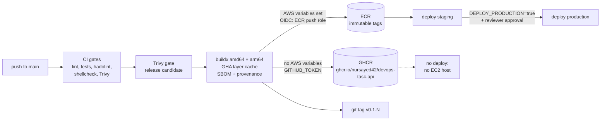

# CI/CD

Five workflows under `.github/workflows/`:

| Workflow | Trigger | What it does |
|----------|---------|--------------|
| `ci.yml` | every PR to `main`; also called by `release.yml` | ruff lint + format check, pytest with an 85% coverage gate (report in the job summary and as an artifact), hadolint, shellcheck, image build, container smoke test (health, non-root UID, graceful SIGTERM), Trivy gate that fails on any CRITICAL CVE, health-script tests, monitoring config checks |
| `terraform.yml` | PRs that touch `terraform/**` or `scripts/deploy.sh` | `terraform fmt`/`validate`, mocked `terraform test` and tflint (AWS ruleset) per stack, Trivy IaC scan that fails on HIGH/CRITICAL |
| `k8s.yml` | PRs that touch `k8s/**`, the kind scripts, the app or the image | kubeconform on the rendered manifests, then a kind end-to-end run (deploy, verify, rollout + rollback, HPA) |
| `release.yml` | push to `main` | the same CI gates, a Trivy gate on the release candidate, multi-arch build, push to **ECR** (primary, when the AWS variables are set) or **GHCR** (fallback, when they are not), then deploy to staging and optional approval-gated production (ECR only) |
| `deploy.yml` | called by `release.yml`, or run by hand | deploy one existing version to one environment: smoke test, automatic rollback |



## Registries

The build job picks the registry at run time. **ECR is used only when all three variables
`AWS_REGION`, `ECR_REPOSITORY` and `AWS_ECR_PUSH_ROLE_ARN` are set; otherwise the image goes to
GHCR.** Everything else is the same on both paths: the version, the Trivy gate before the push,
linux/amd64 + linux/arm64, GHA layer cache, the SBOM and provenance, and the OCI labels.

| | Amazon ECR (primary) | GitHub Container Registry (fallback) |
|--|----------------------|--------------------------------------|
| Image | `<account>.dkr.ecr.<region>.amazonaws.com/devops-task-api` | `ghcr.io/nursayed42/devops-task-api` |
| Authentication | OIDC → `devops-task-github-ecr-push` role (main branch only) | `docker/login-action` with the workflow's own `GITHUB_TOKEN` |
| Job permission used | `id-token: write` | `packages: write` |
| Tag overwrite | impossible: the repository has immutable tags | the pipeline checks first and never pushes an existing tag (GHCR tags are mutable) |
| Linked to this repo | n/a | `org.opencontainers.image.source` label (Dockerfile) and index annotation (build step) |
| Deploy | staging (+ production) via SSM | skipped. The build summary says why: there is no EC2 host. |

A new GHCR package may start as **private**. For anonymous `docker pull`, set it to public under
*Package settings → Danger zone → Change visibility*.

## Versioning and tags

- `VERSION` holds `MAJOR.MINOR`. The pipeline appends the workflow run number as PATCH, so every
  release on `main` gets a unique, increasing semantic version (`0.1.7`, `0.1.8`, …). Bumping
  major/minor is a one-line, reviewed change to `VERSION`.
- Each image gets two tags: `0.1.7` (what we deploy and roll back to) and `sha-<7 chars>`
  (trace an image to its commit). `latest` is never pushed.
- The ECR repository has **immutable tags**, so `0.1.7` can never be overwritten. Deploying or
  rolling back to a version always means exactly the image that was tested under that name.
  On GHCR, where tags are mutable, the pipeline enforces the same rule by checking for the tag
  before pushing. Either way, a job re-run detects that the tag already exists and reuses the image.
- The commit is also tagged `v0.1.7` in git, and the image carries OCI labels with the version,
  commit and build date.

## How a release reaches an environment

`scripts/ci-deploy.sh` (on the runner) drives `scripts/deploy.sh` (on the host, installed as
`/usr/local/bin/deploy-app`):

1. The deploy job assumes the environment's deploy role via OIDC. That role can only run
   `AWS-RunShellScript` on that environment's instance.
2. It finds the running instance by its `Project`/`Environment` tags, so no instance IDs or IPs
   are hardcoded and a replaced host is picked up automatically.
3. **SSM Run Command** runs `deploy-app <image>` on the host. No SSH and no open port 22.
4. On the host: pull the new image first (keeps the gap short), stop the old container with
   SIGTERM (in-flight requests drain), start the new one, then poll `/health` through the
   published port for up to 60s.
   **If it doesn't become healthy, the host restores the previous image itself** and the job fails.
5. From the runner: **external smoke test**. `/health` must answer through the security group,
   and `/` must report the version that was just deployed (this catches a wrong image too).
   **If it fails, the job runs `deploy-app --rollback`** and fails.
6. On success the image is recorded in the SSM parameter `/devops-task/<env>/release-image`. A host
   that Terraform replaces later reads it at boot and starts the same release.

Single-host trade-off: switching containers causes a few seconds of downtime (stop old, start new
on the same port). Zero-downtime on EC2 would need two instances behind an ALB (or blue/green
behind a local reverse proxy). The Kubernetes deployment shows zero-downtime rolling updates.

## Rolling back

| Situation | What happens / what to do |
|-----------|---------------------------|
| New container never becomes healthy | Automatic: the host restores the previous image |
| Healthy on the host but broken from outside (wrong version, SG, …) | Automatic: CI runs `deploy-app --rollback` |
| A bad release passed both checks | **Actions → Deploy → Run workflow**, pick the environment and a previous version (e.g. `0.1.41`). The same checks run on the redeploy. |
| Want the fix in history | `git revert` the change and merge: a new release goes through the full pipeline |
| Emergency, CI unavailable | `aws ssm start-session --target <instance>` then `sudo deploy-app --rollback` |

## Required configuration

**No secrets are needed, for either registry.** GHCR needs no configuration at all: the build job
pushes with the automatic `GITHUB_TOKEN` (`packages: write`). AWS access is OIDC only, and
everything below is a non-sensitive identifier, so it is stored as a *variable*, not a secret.
The `GITHUB_TOKEN` is read-only except in two places: the build job (`packages: write`, used only
on the GHCR path) and the git-tag job (`contents: write`).

Repository variables (*Settings → Secrets and variables → Actions → Variables*):

| Variable | Value | Source |
|----------|-------|--------|
| `AWS_REGION` | `us-east-1` | region used in Terraform |
| `ECR_REPOSITORY` | `devops-task-api` | `terraform -chdir=terraform/shared output -raw ecr_repository_name` |
| `AWS_ECR_PUSH_ROLE_ARN` | `arn:aws:iam::<acct>:role/devops-task-github-ecr-push` | `terraform -chdir=terraform/shared output -raw ecr_push_role_arn` |
| `DEPLOY_PRODUCTION` | `true` (optional) | set once a production host exists |

Environments (*Settings → Environments*):

| Environment | Variable | Protection rules |
|-------------|----------|------------------|
| `staging` | `AWS_DEPLOY_ROLE_ARN` = `terraform output -raw deploy_role_arn` (staging state) | Deployment branches: `main` only |
| `production` | `AWS_DEPLOY_ROLE_ARN` = same output from the production state | Deployment branches: `main` only, **required reviewers** (manual approval) |

The same with the GitHub CLI:

```bash
gh variable set AWS_REGION --body us-east-1
gh variable set ECR_REPOSITORY --body "$(terraform -chdir=terraform/shared output -raw ecr_repository_name)"
gh variable set AWS_ECR_PUSH_ROLE_ARN --body "$(terraform -chdir=terraform/shared output -raw ecr_push_role_arn)"
gh variable set AWS_DEPLOY_ROLE_ARN --env staging --body "$(terraform -chdir=terraform/app output -raw deploy_role_arn)"
```

Until all three AWS variables are set, `release.yml` runs the full CI gates on `main`, then
scans, builds and publishes the multi-arch image to **GHCR** and tags the commit. The two deploy
jobs are skipped, and the build summary says why. Setting the variables switches the same
workflow to ECR and turns the deploys on. Nothing else changes.

Why the trust is safe: the push role only trusts `repo:<owner>/<repo>:ref:refs/heads/main`, and each
deploy role only trusts `repo:<owner>/<repo>:environment:<env>`. A PR branch or a fork cannot get
AWS credentials, and production credentials need the production Environment, which needs approval.

## Security gates and supply chain

- Every third-party action is pinned to a full commit SHA (tags can be moved). Linters run from
  official images pinned by digest.
- Workflows default to `contents: read`. `id-token: write` is granted only to jobs that assume
  an AWS role, `packages: write` only to the release build job, and `persist-credentials: false`
  keeps the token out of `.git/config`.
- CI fails on: lint/format errors, failed tests, coverage < 85%, hadolint findings, shellcheck
  findings, a container that is unhealthy, runs as root or ignores SIGTERM, and **any CRITICAL CVE**
  in the image (exceptions only via `.trivyignore` with an expiry date).
- The release job repeats that Trivy gate on the exact release candidate (same Dockerfile and
  build args, linux/amd64) **before anything is pushed**, to either registry.
- Release images carry an SBOM and max-mode build provenance (BuildKit attestations) in both
  registries, and ECR re-scans them on push.
