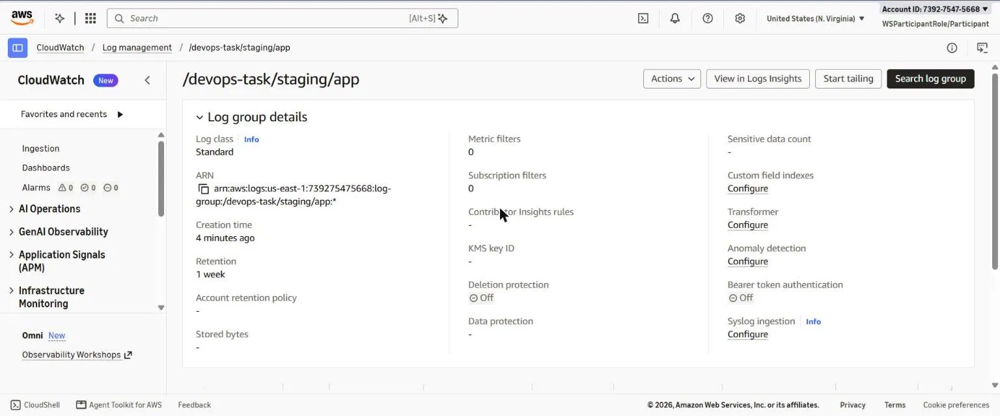

# AWS sandbox run: staging (us-east-1)

- **Account:** 739275475668
- **Identity:** `assumed-role/WSParticipantRole/Participant` (AWS Workshop Studio sandbox)
- **Terraform:** 1.17.2, AWS provider 6.73.0, region `us-east-1`

## What the sandbox role may do

`aws iam list-attached-role-policies --role-name WSParticipantRole` shows four managed policies
and no inline policy:

| Policy | Grants |
|--------|--------|
| `ReadOnlyAccess` | read-only on every service |
| `ws-default-policy` | IAM read (`List*/Get*`), `CreateServiceLinkedRole`, `PassRole` on itself only; **denies everything outside us-east-1** |
| `CloudWatchAgentServerPolicy` | `logs:CreateLogGroup/CreateLogStream/PutLogEvents/PutRetentionPolicy/Describe*`, metrics |
| `AmazonSSMManagedInstanceCore` | the SSM agent's calls |

Nothing allows `s3:CreateBucket`, `ec2:RunInstances`, `ec2:CreateSecurityGroup`,
`ecr:CreateRepository`, `iam:CreateRole`, `iam:CreateOpenIDConnectProvider` or `logs:TagResource`.

## Result per stack

| Step | Log | Result |
|------|-----|--------|
| bootstrap init / plan | `01`, `02` | OK: **Plan: 7 to add** (state bucket, versioning, SSE, public access block, ownership, TLS-only policy, lifecycle) |
| bootstrap apply | `03` | **Denied:** `s3:CreateBucket` ("no identity-based policy allows"). Nothing created. |
| EC2 permission dry-runs | `04` | `RunInstances` and `CreateSecurityGroup`: **UnauthorizedOperation** (checked with `--dry-run`, nothing created) |
| shared init / plan (local backend override, since there is no state bucket) | `05`, `06` | OK: **Plan: 5 to add** (ECR repo + lifecycle policy, GitHub OIDC provider, ECR push role + policy) |
| shared apply | `07` | **Denied:** `ecr:CreateRepository`, `iam:CreateOpenIDConnectProvider`. The push role and its policy were never attempted, because they depend on both. Nothing created. |
| app (staging) init / full plan | `08`, `09` | **Fails at plan:** the data sources for the ECR repository and the OIDC provider find nothing, because the shared stack could not be created. Before the error, Terraform read the default VPC, subnets and AMI and planned the 7 resources that don't depend on them ("Plan: 7 to add") |
| app: `-target=aws_cloudwatch_log_group.app` plan / apply | `10`, `11` | Plan OK (1 to add). Apply **denied**: "CreateLogGroup with Tags… additional permission `logs:TagResource` is required" (the provider's `default_tags`) |
| same, default tags switched off via a local, git-ignored `provider_override.tf` | `12`, `13` | **Applied:** `aws_cloudwatch_log_group.app` = `/devops-task/staging/app`, retention 7 days (screenshot `14-cloudwatch-log-group.png`) |
| destroy the log group (`-target`) | `15` | **Denied:** `logs:DeleteLogGroup` ("no identity-based policy allows"). The role can create log groups but not delete them. |

**Left in the account:** the empty log group `/devops-task/staging/app` (7-day retention, no
cost). The sandbox role cannot delete it, and it goes away when the Workshop Studio account is
torn down. Lesson noted: check for the matching `Delete*` permission before creating anything in a
restricted account.

**Local cleanup done:** the override files, local state and `.terraform` dirs were removed (the
committed provider lock files were kept), and the `devops-sandbox` profile was removed from
`~/.aws/credentials` and `~/.aws/config`, leaving `[default]` untouched.

## What it shows / what it doesn't

- The code plans cleanly against a real account in us-east-1, apart from the cross-stack lookups in
  `app`, which need `shared` to exist first.
- Bucket names and ARNs come from the account automatically (`devops-task-tfstate-739275475668`).
- A full apply (EC2 host, IAM roles, ECR, OIDC) and the CI deploy to EC2 need an account where
  the identity can create those resources. This sandbox is read-only by design.
