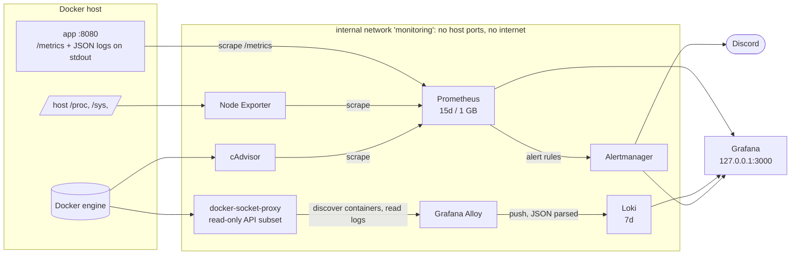
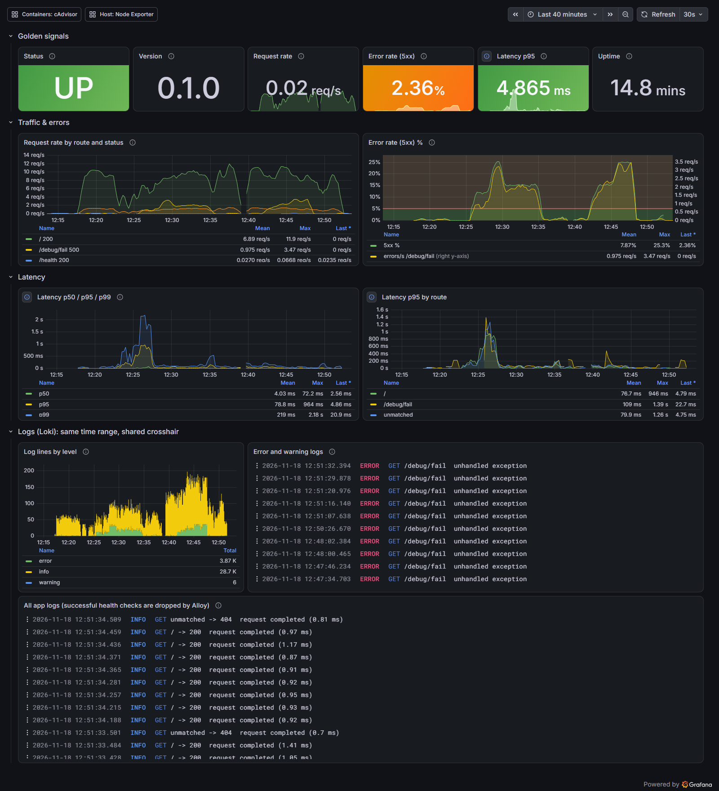
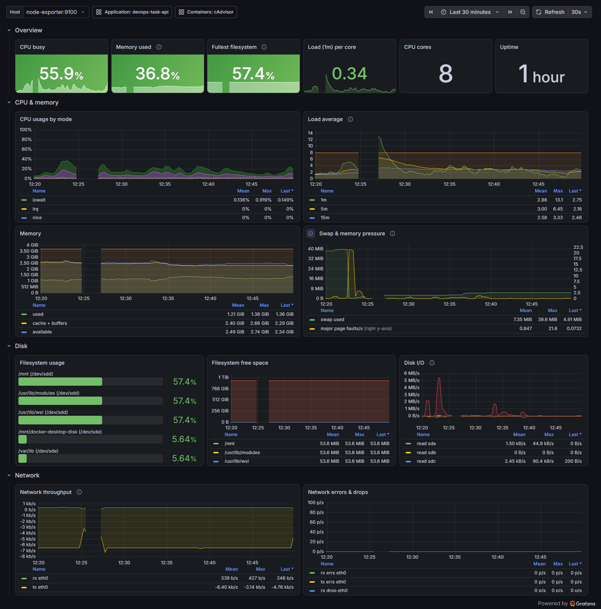
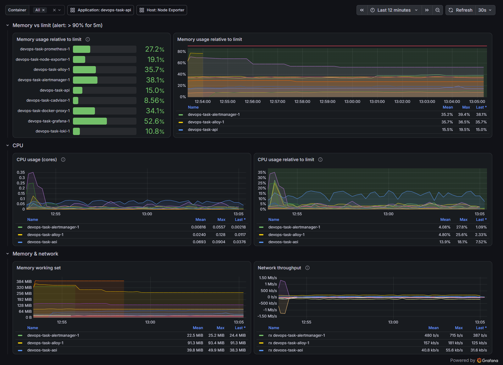

# Observability stack

Prometheus, Grafana, Loki, Grafana Alloy, Node Exporter and cAdvisor (plus Alertmanager), all
defined in [`docker-compose.monitoring.yml`](../docker-compose.monitoring.yml) and configured from
files under [`monitoring/`](../monitoring). Nothing is set up by hand in a UI.

## Run it

```bash
cp .env.example .env                                         # optional: app settings, Grafana user
openssl rand -base64 18 > secrets/grafana_admin_password     # required, see secrets/README.md
docker compose up -d                                         # app + the whole stack
```

| What | Where |
|------|-------|
| Grafana | http://localhost:3000, user `admin` (or `GRAFANA_ADMIN_USER`), password from `secrets/grafana_admin_password`. Home is the Application dashboard; all three are in the **DevOps Task** folder. |
| App | http://localhost:8080 |
| Everything else | not reachable from the host, by design |

`docker compose up -d app` starts the app alone. To see errors on the dashboards, start the app with
the opt-in fault-injection route and generate some traffic:

```bash
FAULT_INJECTION=true docker compose up -d app
for i in $(seq 1 300); do curl -s -o /dev/null localhost:8080/; curl -s -o /dev/null localhost:8080/debug/fail; sleep 0.2; done
```

## How data flows



## Components, exposure and privileges

| Component | Image (pinned by tag **and** digest) | Published port | Networks |
|-----------|--------------------------------------|----------------|----------|
| Grafana | `grafana/grafana:13.3.1` | `127.0.0.1:3000` only | monitoring, grafana-ui |
| Prometheus | `prom/prometheus:v3.16.0` | none | monitoring |
| Loki | `grafana/loki:3.7.10` | none | monitoring |
| Alloy | `grafana/alloy:v1.22.0` | none | monitoring |
| Node Exporter | `prom/node-exporter:v1.12.1` | none | monitoring |
| cAdvisor | `ghcr.io/google/cadvisor:v0.61.0` | none | monitoring |
| Alertmanager | `prom/alertmanager:v0.35.0` | none | monitoring, alert-egress |
| docker-socket-proxy | `tecnativa/docker-socket-proxy:v0.5.0` | none | monitoring |

`monitoring` is an `internal: true` network, so nothing on it is reachable from the host and it has
no route out. Grafana also joins `grafana-ui`, because a port can only be published from a
non-internal network, and binds it to 127.0.0.1 so it isn't on the LAN either. Alertmanager also
joins `alert-egress`, as the one component that must reach the internet (Discord). The app joins
`monitoring` so Prometheus can scrape it without exposing `/metrics` anywhere else.

Every monitoring container runs with `no-new-privileges`, CPU/memory limits, bounded `json-file`
logs, and (except the socket proxy) a **read-only root filesystem**. Alloy defaults to root and is pinned to
its image's unprivileged `alloy` user (473).

### Host access granted to Node Exporter and cAdvisor (and why)

| Container | Mount / privilege | Why it needs it |
|-----------|-------------------|-----------------|
| Node Exporter | `/` → `/host` **read-only**, with `--path.rootfs=/host` | reads the host's `/proc` (CPU, memory, load), `/sys` (disks, hardware) and filesystems (disk usage) instead of the container's own |
| | `pid: host` | sees host processes (process counts, per-process stats) |
| | `cap_drop: ALL`, read-only rootfs | it only reads files, so no capabilities at all |
| cAdvisor | `/` → `/rootfs`, `/sys`, `/var/lib/docker`, `/dev/disk` **read-only** | cgroup statistics (CPU, memory, I/O per container) live in `/sys/fs/cgroup`; disk and filesystem stats need the rest |
| | `/dev/kmsg` device | reads kernel messages to detect OOM kills (`container_oom_events_total`) |
| | `/run/containerd/containerd.sock` read-only | **required with Docker 29's containerd image store**: without it cAdvisor's Docker factory fails to register and reports no named containers at all (verified) |
| | `/var/run/docker.sock` read-only | maps cgroups to container names and labels |
| | *not* `--privileged` | upstream's example uses it; every metric used here works without it |

Both sockets are root-equivalent: `:ro` makes the socket file read-only, not the API behind it.
That is accepted for cAdvisor because it is a host agent by nature (upstream runs it `--privileged`).
Here it at least runs **unprivileged**, read-only, without capabilities beyond the defaults, and with
no published port. cAdvisor first reached Docker through the socket proxy below, but given the
containerd socket that gained nothing. It also added a failure mode: containers created while the
proxy restarted showed up as bare IDs on the Containers dashboard.

**Alloy** reaches Docker only through **docker-socket-proxy**. The proxy exposes a GET-only subset
(`CONTAINERS`, `NETWORKS`) and refuses everything else (POST/DELETE, exec, images, volumes, …).
Alloy is the component that parses untrusted log content, so it gets nothing but that read-only view.

## Metrics

Prometheus scrapes every 15 s: the app's `/metrics`, Node Exporter (host), cAdvisor (containers),
and Prometheus, Loki, Alloy, Grafana and Alertmanager themselves, so a dead monitoring component
alerts too (`MonitoringTargetDown`).

**Retention: 15 days or 1 GB, whichever comes first** (`--storage.tsdb.retention.time/size`).
That covers "what changed since last week?" while the size cap protects the host disk. Long-term
history would go to remote storage (Mimir/Thanos), not a single local TSDB.

The app keeps metric cardinality bounded: `path` is the route template (`/`, `/health`,
`unmatched`), not the raw URL. Node Exporter drops pseudo filesystems (`tmpfs`, `overlay`, `9p`
host shares, …), and cAdvisor keeps only two container labels
(`--store_container_labels=false --whitelisted_container_labels=com.docker.compose.*`).

## Logs

[Alloy](../monitoring/alloy/config.alloy) discovers containers through the Docker API (the proxy),
tails their stdout/stderr, and pushes to Loki:

1. **Labels (indexed, low cardinality):** `service` (Compose service, ~10 values), `container`,
   `stream` (stdout/stderr), `level` (~5 values), plus `environment`. That is ~10–20 streams in total.
2. **App logs are parsed as JSON.** `level` becomes a label: it is the dimension you filter on first
   and has five values. `path`, `method` and `status` become **structured metadata**: they are
   attached to each line and filterable without parsing (`{service="app"} | status=~"5.." | path="/"`),
   but do not create new streams. They are bounded, yet path × method × status × level as labels
   would multiply the stream count for no benefit. Request IDs, client IPs and durations stay in the
   log body: high-cardinality fields must never be labels.
3. The app's own `timestamp` field becomes the log time, not the time Alloy read the line.
4. **Successful `/health` checks and `/metrics` scrapes are dropped** at the collector (~8
   lines/minute of noise). Non-200 probes are kept. Alloy counts what it drops
   (`loki_process_dropped_lines_total{reason="successful_probe"}`).
5. Other services' logfmt `level=` is extracted as well, and every level is lower-cased, so
   `{level="error"}` works across the whole stack.

**Retention: 7 days** (Loki compactor with `retention_enabled`). Logs are for investigating recent
incidents; the trends live in Prometheus.

## Dashboards

All three are provisioned from [`monitoring/grafana/dashboards/`](../monitoring/grafana/dashboards)
and are read-only in the UI (`allowUiUpdates: false`): the JSON in git is the source of truth. They
share a crosshair, link to each other, and carry descriptions on non-obvious panels.

| Dashboard | Shows |
|-----------|-------|
| **Application** | status, version, uptime; request rate by route/status; 5xx error rate with the alert threshold drawn in; latency p50/p95/p99 and p95 by route; **Loki log volume by level, error/warning logs and all app logs on the same time axis** |
| **Host** | CPU busy and by mode, load per core, memory (used/cache/available), swap and major faults, usage per filesystem, free space, disk I/O, network throughput and errors |
| **Containers** | per-container CPU (cores, and % of the CPU limit), memory working set, **memory as % of the configured limit** (with the 90% alert line), network |

The dashboards already paid for themselves while this stack was built. They showed:
- Grafana at 87–95% of its 384 MiB limit and Loki at 78% of 512 MiB (both limits raised)
- every application failure logged twice, once by the app and once by uvicorn (fixed in the app's
  middleware: one structured line with the traceback)
- containers losing their names (fixed by the cAdvisor change above)





## Alerting

[11 Prometheus rules](../monitoring/prometheus/rules/alerts.yml), unit-tested with
`promtool test rules` ([tests](../monitoring/prometheus/tests/alerts_test.yml)). The tests cover
firing *and* not firing, e.g. an idle service with one failed request, or a read-only disk at 100%.
One test was checked against a deliberately broken rule: an operator-precedence bug that would have
silenced the disk alerts completely.

| Alert | Condition | `for` | Severity | Why this threshold and duration |
|-------|-----------|-------|----------|---------------------------------|
| AppDown | `up{job="app"} == 0` | 1m | critical | 4 failed scrapes in a row: a quick restart or one lost scrape doesn't page, a dead app is known within a minute |
| AppHighErrorRate | 5xx > 5% of requests (health probes excluded) **and** > 0.1 req/s | 5m | critical | 5% means one user in twenty is failing. 5 minutes filters a burst from a single bad client. The traffic guard stops one failure on an idle service reading as 100%. |
| AppHighLatencyP95 | p95 > 500 ms | 10m | warning | far above normal (single-digit ms) but sustained, so not a GC pause; the service still answers, hence warning |
| HostDiskUsageHigh | filesystem > 80% (writable only) | 10m | warning | leaves room to clean up or grow calmly; 10 minutes ignores a temporary file such as an image pull |
| HostDiskUsageCritical | > 90% | 5m | critical | services start failing writes soon after |
| HostDiskWillFillIn24Hours | 6 h trend projected 24 h ahead < 0 | 30m | warning | catches a fast-growing disk long before the static thresholds |
| HostHighCpuUsage | > 90% | 15m | warning | deploys and batch jobs spike briefly; a quarter of an hour means undersized or runaway |
| HostLowMemory | < 10% available | 10m | warning | the next spike risks the OOM killer (page cache already counts as available) |
| ContainerMemoryNearLimit | working set > 90% of limit | 5m | warning | one more burst and the kernel kills it; containers without a limit are excluded |
| ContainerOomKilled | any OOM event in 5 min | none | critical | an OOM kill already lost in-flight work, so there is nothing to wait for |
| MonitoringTargetDown | any other target down | 5m | warning | a blind spot, not an outage |

**Routing (bonus): Alertmanager → Discord.** Alerts are grouped by name and severity. Repeats come
every 1 h for critical and 4 h for warning, and resolved alerts are announced. Inhibition mutes the
error-rate and latency alerts while `AppDown` fires, and the disk warning while the critical one
fires. The webhook URL is a secret file (`secrets/alertmanager/discord_webhook_url`). Without it,
firing alerts are still visible in Grafana (**Alerting → Alert groups**, via the provisioned
Alertmanager data source).

Observed end to end in this setup: with ~25% of requests failing, `AppHighErrorRate` went *pending*
at 06:26:56 and *firing* at 06:32:01 (the 5-minute `for`), reached Alertmanager, and showed up in
Grafana.

## Walkthrough: "An error spike appears on the Application dashboard. How do you find the cause?"

1. **Confirm and scope it (Application → Traffic & errors).** The *Error rate (5xx) %* panel shows
   when it started and how high it is against the 5% alert band. Its second series, *errors/s by
   path*, shows **which route** fails. *Request rate by route and status* answers "everything, or
   one endpoint?": in the demo `/debug/fail 500` rises while `/ 200` stays flat.
2. **Read the logs at the same moment, same screen.** Scroll down: *Log lines by level* has an
   `error` bar exactly under the spike (shared crosshair), and *Error and warning logs* lists one
   line per failure, e.g. `ERROR GET /debug/fail  unhandled exception`. Expanding it shows every
   JSON field and the **traceback** (`RuntimeError: fault injected via /debug/fail` in
   `app/main.py`). That is the root cause, or at least the failing code path.
3. **Narrow it down in Explore (Loki)** with the structured metadata, no regex over raw text needed:
   - `{service="app", level="error"} | path="/debug/fail"` for this route's errors only
   - `sum by (path) (count_over_time({service="app"} | status=~"5.." [1m]))` for the error volume per route
4. **Rule out the platform.** On *Containers*: is the app near its memory limit or CPU-throttled
   (100% of its CPU limit)? Did it get OOM-killed (`ContainerOomKilled`)? On *Host*: disk full, memory
   exhausted? On *Application*: did *Uptime* reset (a crash or restart), and is the *Version* new?
5. **Decide.** If the spike started with a new *Version*, roll back: run the Deploy workflow with
   the previous version (see [docs/ci-cd.md](ci-cd.md)), then fix forward. If it's one route with a
   clear traceback, fix the code. If the platform is the cause (OOM, full disk), fix the resource.
   Either way `AppHighErrorRate` will already have paged after 5 minutes, and it auto-resolves
   (with a "resolved" message) once the rate drops.

## Validation

- **CI** ([`ci.yml`](../.github/workflows/ci.yml), job *Monitoring config & alert rule tests*) runs
  on every PR, using the images pinned in Compose:
  - `docker compose config`
  - `promtool check config` and `promtool test rules`
  - `amtool check-config`
  - `loki -verify-config`
  - an `alloy fmt` diff
  - a dashboard check: valid JSON, unique uids, only provisioned data sources
- **Locally:** every dashboard query was executed through Grafana's data-source proxy against live
  data (49 queries, all returning series), and the screenshots above come from the running stack.

## Known limitations and trade-offs

- **Node Exporter's network panels show its own network namespace.** The task requires every
  component except Grafana to sit on an internal network. Real host NIC counters need
  `network_mode: host`, which would also put port 9100 on the host. CPU, memory, disk and load
  *are* the host's (read through `/host/proc` and `/host/sys`). On a server, run node_exporter in
  the host network namespace on a private interface (or as a systemd unit) and scrape it there.
- **No `rslave` on the rootfs mount.** Docker Desktop's VM root isn't a shared mount and rejects
  it. On a Linux server add `,rslave` so filesystems mounted after start-up are seen.
- **Loki and Alloy have no Docker healthcheck.** Their images are distroless (no shell or wget).
  Their liveness is covered by Prometheus scraping them and `MonitoringTargetDown`.
- **cAdvisor holds the Docker and containerd sockets** (see the privileges table). Without the
  containerd one it reports no named containers at all under Docker 29. On Kubernetes this goes
  away: the kubelet embeds cAdvisor.
- **Single node, local storage.** Fine for one host. For more, use Prometheus remote-write to
  Mimir or Thanos, and Loki/Tempo on object storage. On Kubernetes, use kube-prometheus-stack.
- **Grafana's admin password is applied only when its database is created.** Rotate it with
  `grafana cli admin reset-admin-password` (see `secrets/README.md`). Grafana's own entrypoint falls
  back to admin/admin when the secret file can't be read. When the file is missing, Docker even
  mounts an empty *directory* in its place. Both happened while testing this setup, so the Compose
  entrypoint refuses to start Grafana unless the secret is a regular, non-empty file.
